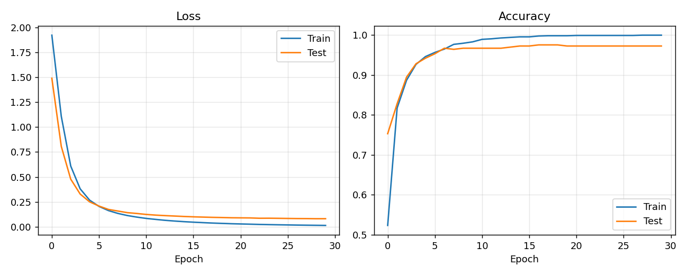
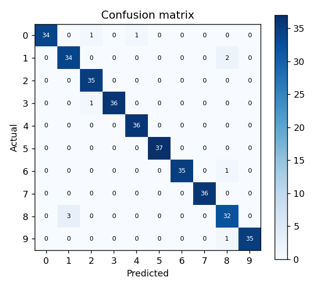

# Handwritten Digit Recognition with an Artificial Neural Network

A feedforward neural network built in PyTorch that classifies handwritten digits, wrapped in an interactive Streamlit web application for testing the model, training new variants and exploring hyperparameter experiments.

> **Course project:** Lab 7, *Open-Ended Lab I*, for **Artificial Neural Networks & Deep Learning**, 5th Semester, BS Artificial Intelligence, **DUET**.

---

## Table of Contents
1. [Why this project exists](#why-this-project-exists)
2. [Objectives](#objectives)
3. [Dataset](#dataset)
4. [Model and training setup](#model-and-training-setup)
5. [Application features](#application-features)
6. [Project structure](#project-structure)
7. [Installation and usage](#installation-and-usage)
8. [Baseline results](#baseline-results)
9. [Experiments](#experiments)
10. [Key findings](#key-findings)
11. [Limitations](#limitations)
12. [Future work](#future-work)
13. [Tech stack](#tech-stack)

---

## Why this project exists

This project was built for **Lab 7 (Open-Ended Lab I)** of the *Artificial Neural Networks & Deep Learning* course in the 5th semester of the BS Artificial Intelligence program at DUET.

The lab was deliberately open-ended. Instead of following fixed steps, students had to choose their own problem, design and implement an ANN in PyTorch or TensorFlow, train and evaluate it, experiment with hyperparameters and architecture, and reflect on what they learned. The lab's stated learning outcomes were to:

- design and implement a basic ANN model,
- train it on real or synthetic data,
- analyze performance using relevant metrics,
- experiment with hyperparameters and architecture, and
- gain experience debugging and iterating on model design.

The original lab deliverable was a single Python script and a written report (Abstract, Theory, Code and Findings). This repository extends that work into a complete, runnable project: the code is organized into reusable modules, the experiments are reproducible from one command, and a web interface makes the model and its behaviour easy to explore without reading the code.

## Objectives

- Build a multiclass classifier for handwritten digits using a fully connected ANN.
- Train and evaluate it with a proper train/test split, tracking loss and accuracy per epoch.
- Study how **architecture** (depth and width), **learning rate**, **activation function** and **optimizer** affect training speed, stability and accuracy.
- Analyze results with learning curves, a confusion matrix and per-class precision, recall and F1-score.
- Present the work in an interactive application.

## Dataset

| Property | Value |
|---|---|
| Source | scikit-learn `load_digits` (a small MNIST-style dataset) |
| Samples | 1,797 images |
| Input | 8×8 grayscale images, flattened to 64 features (pixel values 0 to 16) |
| Classes | 10 (digits 0 to 9) |
| Split | 80% train (1,437) / 20% test (360), stratified, `random_state=42` |
| Preprocessing | Standardization (zero mean, unit variance) using **training-set statistics only**, to avoid data leakage |

The dataset is small enough to train in seconds on a CPU, which made it practical to run many controlled experiments.

## Model and training setup

**Baseline architecture**

```
Input (64) -> Linear(64, 64) -> ReLU -> Linear(64, 10) -> logits
```

| Component | Choice |
|---|---|
| Hidden layers | 1 layer, 64 neurons |
| Activation | ReLU |
| Output layer | 10 logits (softmax is applied inside the loss) |
| Loss | Cross-Entropy |
| Optimizer | Adam, learning rate 0.001 |
| Batch size | 32 |
| Epochs | 30 |
| Seed | 42 |

All experiments use the same seed, data split and number of epochs, and change **one factor at a time** from this baseline so that differences can be attributed to that factor.

## Application features

The Streamlit app has four tabs.

**Predict**
- *Test sample:* browse the held-out test images and compare the prediction with the true label.
- *Edit pixels:* edit the 8×8 pixel grid by hand (values 0 to 16) and watch the prediction change.
- *Upload image:* upload a picture of a single digit. It is inverted if needed, cropped to the digit, converted to a 32×32 bitmap and reduced to 8×8 by counting on-pixels in 4×4 blocks (the way the Digits dataset was built), with thin strokes thickened to match the training data.
- Every prediction shows the predicted class, confidence and a probability bar chart for all 10 digits.

**Train your own**
- Choose the number of hidden layers (1 to 4), neurons per layer, activation function, optimizer, learning rate and epochs.
- The loss curve updates live while training.
- After training: test and train accuracy, test loss, loss and accuracy curves, and a confusion matrix.
- One click makes the newly trained model the active model in the Predict tab.

**Experiments**
- Tables and charts for the four experiments described below, plus the baseline learning curves and confusion matrix.

**About**
- A short summary of the problem, setup, findings and limitations.

## Project structure

```
ann-digit-recognition/
├── app.py              Streamlit interface
├── train.py            Trains the baseline, saves the model, runs all experiments
├── test_app.py         Headless smoke test of the app
├── requirements.txt    Python dependencies
├── src/
│   ├── data.py         Dataset loading, splitting and standardization
│   ├── model.py        Network builder, optimizer factory, save/load helpers
│   ├── train.py        Training loop with per-epoch history and callbacks
│   └── evaluate.py     Probability prediction and confusion-matrix figure
├── models/
│   └── digit_model.pt  Saved baseline model
└── results/
    ├── results.json    Histories and final metrics of every experiment
    ├── curves.png      Baseline learning curves
    └── confusion_matrix.png
```

## Installation and usage

Requires Python 3.9 or newer.

```bash
python -m venv .venv
source .venv/bin/activate        # Windows: .venv\Scripts\activate
pip install -r requirements.txt
```

Run the app:

```bash
streamlit run app.py
```

Regenerate the saved model and every experiment result (takes about a minute on a CPU):

```bash
python train.py
```

Run the smoke test:

```bash
python test_app.py
```

## Baseline results

| Metric | Train | Test |
|---|---|---|
| Accuracy | 99.93% | 97.22% |
| Loss | 0.0131 | 0.0805 |



Loss falls quickly during the first 10 epochs and then flattens. Training accuracy is higher than test accuracy, a small generalization gap that is expected on a dataset this size. The confusion matrix shows that digits **1** and **8** are the hardest classes (F1 of about 0.93 and 0.90), while the remaining digits score higher.



## Experiments

Each table is one controlled experiment. Every configuration was trained once (seed 42).

### 1. Number of layers and neurons (Adam, lr 0.001)

| Configuration | Train loss | Train acc. | Test loss | Test acc. |
|---|---|---|---|---|
| 1x16 | 0.0579 | 99.23% | 0.1143 | 96.39% |
| 1x64 | 0.0131 | 99.93% | 0.0805 | 97.22% |
| 1x128 | 0.0061 | 100.00% | 0.1052 | 98.06% |
| 2x64 | 0.0020 | 100.00% | 0.0904 | 97.50% |
| 3x64 | 0.0009 | 100.00% | 0.1023 | 97.22% |

### 2. Learning rate (Adam)

| Configuration | Train loss | Train acc. | Test loss | Test acc. |
|---|---|---|---|---|
| lr=0.0001 | 0.4590 | 91.72% | 0.4708 | 90.56% |
| lr=0.001 | 0.0131 | 99.93% | 0.0805 | 97.22% |
| lr=0.01 | 0.0002 | 100.00% | 0.0594 | 98.06% |
| lr=0.1 | 0.2549 | 99.72% | 11.3747 | 94.72% |

### 3. Activation function (Adam, lr 0.001)

| Configuration | Train loss | Train acc. | Test loss | Test acc. |
|---|---|---|---|---|
| ReLU | 0.0131 | 99.93% | 0.0805 | 97.22% |
| Sigmoid | 0.0907 | 98.89% | 0.1339 | 97.22% |
| Tanh | 0.0224 | 99.86% | 0.0873 | 97.50% |

### 4. Optimizer

Plain SGD and SGD with Momentum use lr 0.01; RMSProp and Adam use lr 0.001.

| Configuration | Train loss | Train acc. | Test loss | Test acc. |
|---|---|---|---|---|
| SGD | 0.2251 | 95.62% | 0.2465 | 94.44% |
| Momentum | 0.0155 | 100.00% | 0.0973 | 97.22% |
| RMSProp | 0.0023 | 100.00% | 0.0622 | 97.78% |
| Adam | 0.0131 | 99.93% | 0.0805 | 97.22% |

## Key findings

- **Width helps, depth does not (here).** Going from 16 to 128 neurons in one hidden layer raised test accuracy from 96.39% to 98.06%. Adding a second or third hidden layer pushed training loss close to zero but did not improve test accuracy, and test loss stayed higher, a mild sign of overfitting on about 1,400 training samples.
- **Learning rate is the most sensitive hyperparameter.** 0.0001 was too slow to converge in 30 epochs, 0.001 and 0.01 both worked (0.01 was best), and 0.1 was unstable: test loss exploded and accuracy dropped.
- **ReLU and Tanh converge faster than Sigmoid.** Final accuracy was similar for all three, but Sigmoid reached a higher training loss because its saturating, non-zero-centred output slows learning.
- **Adaptive optimizers and momentum beat plain SGD.** Plain SGD was clearly the slowest; Momentum, RMSProp and Adam all converged much faster.

## Limitations

- Each configuration was run **once**. With only 360 test images, a difference of about 1 percentage point equals roughly 3 images and is within noise.
- The dataset is small and low-resolution (8×8), so results do not transfer directly to full-size MNIST or real handwriting.
- Uploaded images are out-of-distribution. On 1,500 real MNIST test digits fed through the upload pipeline, the model reaches about 55%, versus 97% on the Digits test set, because of differences in stroke style and resolution. Dataset digits re-rendered as large images are recognized about 90% of the time. Expect frequent mistakes on photos and hand-drawn images.
- The *Train your own* tab warns when training becomes unstable (for example, 4 layers × 256 neurons with Adam at learning rate 0.01 reaches about 97% and then collapses).
- No regularization (dropout, weight decay, early stopping) is used.

## Future work

- Repeat experiments over several seeds and use cross-validation to report mean and standard deviation.
- Add dropout, weight decay and early stopping.
- Move to full MNIST with a convolutional network and compare against this fully connected baseline.
- Add a drawing canvas to the Predict tab.
- Train with data augmentation (shifts, rotations, stroke thickness) to improve robustness on real-world images.

## Tech stack

- **Python**, **PyTorch** (model and training)
- **scikit-learn** (dataset, split, confusion matrix)
- **NumPy**, **pandas**, **Matplotlib**, **Pillow**
- **Streamlit** (web interface)